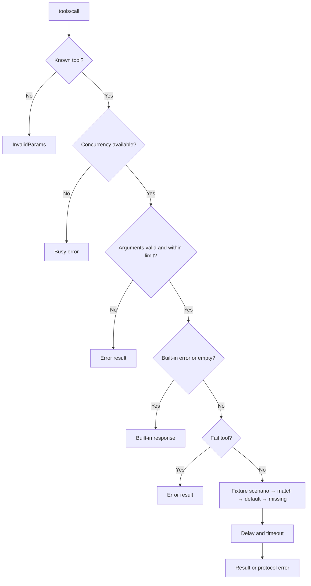

# Architecture

This is a MOCK MCP server: fixtures supply responses; no snapshot or fixture content is executed and no real tool actions, network calls, forwarding, or child processes occur. The optional user-selected report is the only file write.

## Modules and flow

The CLI (`bin/`, `src/cli.js`, `src/args.js`) loads options and inputs. `src/input/read.js` reads bounded JSON; `snapshot.js` and `fixtures.js` validate it. `src/schema/arguments.js` validates the supported argument-schema subset. `src/server/runtime.js` exposes the SDK stdio server; `responder.js` selects responses and `recorder.js` records masked calls and creates reports. `src/index.js` exports the public API. `src/util/object.js` supports safe object handling.

Snapshot → input validation → tool catalog; fixtures → input validation → response selection. Client requests enter over stdio; responses return over stdio. Recording stays in memory until an explicitly requested report is written on shutdown.

## Request resolution order

1. Reject an unknown tool with InvalidParams.
2. Reject a call over the concurrency limit with a busy protocol error.
3. Reject oversized arguments; validate the supported schema subset unless disabled.
4. Apply built-in `server-error`, `error`, or `empty`.
5. Apply an exact `--fail-tool` match.
6. Select a fixture scenario response, first matching arguments, default response, or missing-fixture behavior, in that order.
7. Apply response delay and any `slow` minimum, subject to the call timeout; return a copied result or a protocol error.

## Safety boundaries

Inputs are bounded and treated as untrusted data. Fixture structural keys are strict and prototype-sensitive names are rejected outside response payload data. Schema and argument keys remain data. Diagnostics avoid values and file contents; untrusted text is sanitized. Reports mask known sensitive argument keys by default, but should still be reviewed before sharing. See [SECURITY.md](SECURITY.md).
